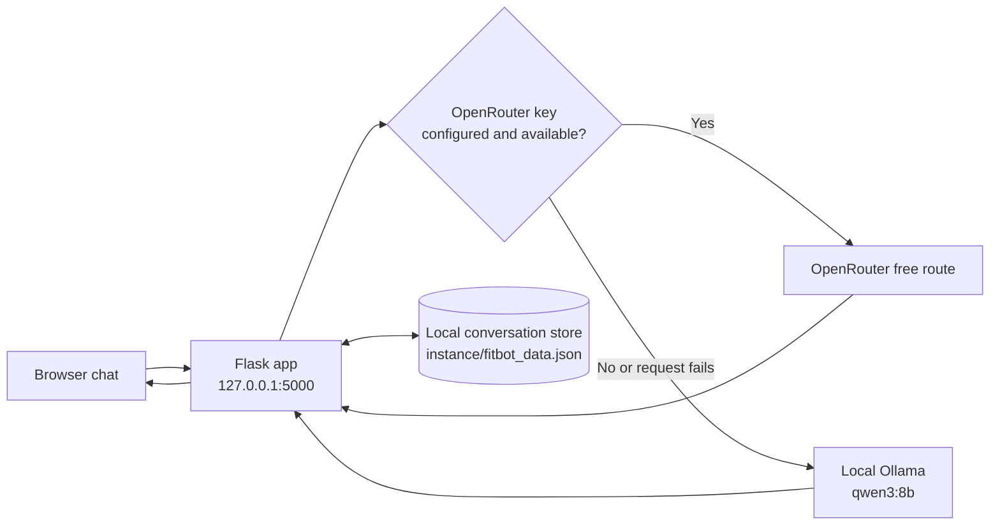

# FitBot Health 🩺

**A polished, local-first healthcare education chatbot for a college demonstration.** FitBot uses OpenRouter's free route when configured and falls back to the local Ollama `qwen3:8b` model.

> [!WARNING]
> FitBot is an educational prototype, not a medical device. It cannot diagnose, prescribe, or replace a qualified clinician. For an emergency, contact local emergency services.


**Explore:** [Quick start](#-quick-start) · [How it works](#-how-it-works) · [Features](#-features) · [Five demo prompts](#-five-message-demo) · [Privacy and safety](#-privacy-and-safety) · [Troubleshooting](#-troubleshooting)

<details open>
<summary><strong>▶ Quick start on Windows</strong></summary>

1. Install Python 3.10 or newer. Install [Ollama](https://ollama.com/download) if you want the local backup, and make sure `qwen3:8b` is present in its model library.
2. Open PowerShell in the project folder and prepare the environment:

   ```powershell
   py -m venv .venv
   .\.venv\Scripts\Activate.ps1
   python -m pip install -r requirements.txt
   Copy-Item .env.example .env
   notepad .env
   ```

3. In `.env`, optionally paste your OpenRouter key after `OPENROUTER_API_KEY=`. Leave it blank to use Ollama directly. The key stays in this local file; **never commit `.env`**. A blank `FLASK_SECRET_KEY` is replaced with a generated key saved under the ignored `instance` folder.
4. If your Ollama models are stored in a custom folder, set the path before starting. The launcher also checks `D:\AI\Models` and the standard Ollama folder automatically.

   ```powershell
   $env:OLLAMA_MODELS = 'D:\AI\Models'
   .\Start-FitBot.cmd
   ```

5. Open <http://127.0.0.1:5000> and create a local demo account. FitBot opens with a saved sample conversation so the chat is ready to explore; this sample is created locally and does not call a model. The launcher starts Ollama in the background when it finds the model, then starts FitBot and opens the chat.

</details>

<details>
<summary><strong>Manual start and model restart</strong></summary>

Start each service in its own PowerShell window:

```powershell
$env:OLLAMA_MODELS = 'D:\AI\Models'
ollama serve
```

Then, from the project folder in another window:

```powershell
python app.py
```

Leave both windows open while using the demo. If Ollama already runs in the background, close it from the system tray before starting `ollama serve` manually.

</details>

## 🧭 How it works



The default model reply is a short, plain-language answer of about three to four sentences. Ask for more detail when you want a fuller explanation; FitBot displays a progress note for those requests. If OpenRouter is not configured or a request fails, FitBot tries Ollama automatically.

## ✨ Features

- Responsive chat layout with account sign-in, a ready-made starter conversation, saved conversations, new-chat and delete controls.
- Streaming assistant replies, readable Markdown, and language selection.
- OpenRouter `openrouter/free` as the optional primary model; local Ollama `qwen3:8b` as backup.
- Startup and health checks that report whether the model service and configured model are available.
- Healthcare-focused prompts for general education, cautious next steps, and urgent situations.
- Emergency keyword handling that returns immediate emergency guidance without waiting for a model.
- Automatic local Flask session-key generation when no key is configured.

## 💬 Five-message demo

Use fictional, non-identifying examples. The [demonstration report](DEMO_REPORT.md) includes the recorded browser checks and findings from earlier iterations.

| # | Natural prompt | What a safe reply should do |
|---|---|---|
| 1 | “I keep waking up during the night. Is there something simple I could try?” | Offer a few realistic sleep habits and suggest care if it persists. |
| 2 | “My lunches are usually rice and snacks. How can I make them more balanced?” | Suggest accessible food groups without prescribing a diet. |
| 3 | “I've had a headache for a few days. What signs mean I should get medical help?” | Mention urgent warning signs and recommend review for persistent symptoms. |
| 4 | “I forgot my medicine yesterday. Should I take extra today?” | Avoid dose changes; refer to the label, pharmacist, or prescriber. |
| 5 | “I've been stressed about exams and sleeping badly. Could you explain a few things I can try in more detail?” | Give a fuller, focused explanation and show the progress note. |

## 🔐 Privacy and safety

- Without an OpenRouter key, prompts go to the local Ollama service. With a key, the current message and up to six recent conversation messages are sent to OpenRouter; its free route may select different model providers with different data practices.
- Avoid entering names, contact details, account numbers, or private health information into the demo.
- Demo accounts and conversations are stored locally in `instance/fitbot_data.json`. Passwords are stored as hashes.
- The emergency shortcut is keyword-based and may miss context. It is not a substitute for emergency services or professional medical advice.
- `.env`, local databases, account data, and generated session secrets are excluded from Git by `.gitignore`.

## 🧰 Troubleshooting

<details>
<summary><strong>“Ollama is unavailable” or the model is missing</strong></summary>

Check that the Ollama service is running and the model is listed:

```powershell
$env:OLLAMA_MODELS = 'D:\AI\Models'
ollama list
```

If `qwen3:8b` is absent, confirm `OLLAMA_MODELS` points to the folder containing `manifests` and `blobs`. Stop the existing Ollama process from the system tray, then run `ollama serve` in PowerShell with the environment variable set. The web app can still start without Ollama, but local model replies will be unavailable.

</details>

<details>
<summary><strong>PowerShell says scripts are disabled</strong></summary>

You can skip virtual-environment activation and use the environment's Python directly:

```powershell
.\.venv\Scripts\python.exe -m pip install -r requirements.txt
.\.venv\Scripts\python.exe app.py
```

Or run `Start-FitBot.cmd`, which does not require PowerShell script-policy changes.

</details>

<details>
<summary><strong>Replies are slow or a provider limit is reached</strong></summary>

The first local answer can take longer while an 8B model loads, and generation speed depends on available memory and hardware. FitBot allows up to ten minutes for local generation. OpenRouter's free-model availability and request limits can change; if the hosted route is unavailable, FitBot attempts the local backup.

</details>

## 🛠️ Configuration

Copy `.env.example` to `.env`. Common settings:

| Setting | Default | Purpose |
|---|---|---|
| `OPENROUTER_API_KEY` | empty | Optional hosted-model key; keep it private. |
| `OPENROUTER_MODEL` | `openrouter/free` | Hosted route used when a key is configured. |
| `OLLAMA_BASE_URL` | `http://127.0.0.1:11434` | Local Ollama API address. |
| `OLLAMA_MODEL` | `qwen3:8b` | Local backup model tag. |
| `OLLAMA_TIMEOUT` | `600` seconds | Maximum wait for local generation. |

## 🧪 Validation notes

The included [demo report](DEMO_REPORT.md) records previous browser runs, provider fallback behavior, message persistence checks, and Python/JavaScript/mock-stream validations. Model output can vary between providers, so repeat the five prompts during your own live demonstration and judge the actual answers rather than relying on examples.

## 📄 Project status

This repository is a college demonstration project. No open-source license has been added; reuse is subject to the repository owner's permission.
